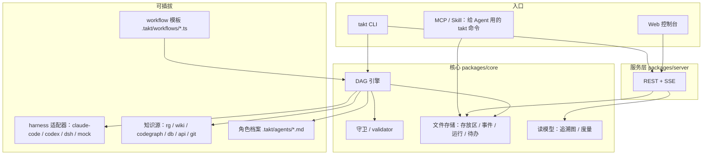
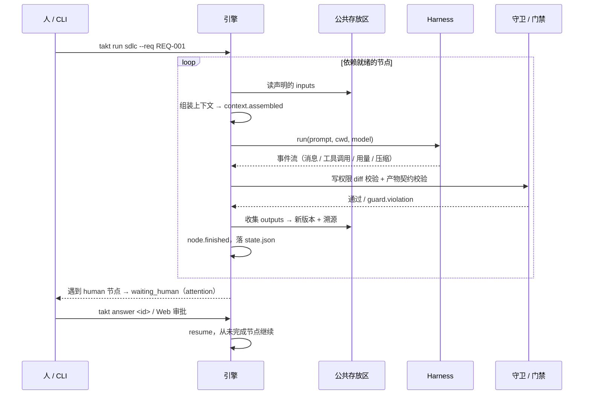

# 02 · 总体架构

## 分层



| 包 | 职责 | 依赖 |
|---|---|---|
| `@taktflow/core` | 类型契约、DSL、引擎、文件存储、守卫、读模型 | 无运行时依赖 |
| `@taktflow/harness` | 各家 harness 的适配器（统一 HarnessAdapter 接口） | core |
| `@taktflow/knowledge` | 知识源与路由器 | core |
| `@taktflow/server` | HTTP API、SSE 事件流、托管 Web 静态文件 | core |
| `@taktflow/cli` | `takt` 命令：init / req / ws / run / status / trace / audit / serve | 以上全部 |
| `@taktflow/web` | React + React Flow 控制台 | core（仅类型） |

## 被管理项目里的目录（`.takt/`）

```
<project>/
  takt.config.json            # 项目配置（TaktConfig）
  .takt/
    agents/<role>.md          # 角色档案：frontmatter + 角色说明
    workflows/<id>.workflow.ts
    workspaces/<REQ-ID>/      # 公共存放区（人和 Agent 都直接读这个目录）
      requirement.json
      manifest.json           # 产物清单：版本、sha、溯源、kind、traceIds
      comments.jsonl
      inputs/ spec/ design/ test-plan/ cases/ tasks/ evidence/ reports/ decisions/ …
    objects/<sha256>          # 内容寻址的历史版本
    runs/<RUN-ID>/
      state.json              # RunState
      events.jsonl            # 只追加 + 哈希链
      context/<nodeId>.json   # 上下文快照与压缩记录
      transcripts/<nodeId>/   # harness 原始 transcript
    attention.jsonl           # 待人处理事项
```

为什么文件优先：人能直接看、Agent 能直接读、git 能审阅、没有服务也能用 CLI 跑。查询性能不够时再加 SQLite 索引（只做索引，事实源仍是文件）。

## 一次运行的时序



## 关键取舍

| 选择 | 原因 | 代价 |
|---|---|---|
| Workflow 用 TS 代码，不用 YAML | 复用函数、类型检查、动态 prompt、planner 展开模板都需要代码 | 非程序员改流程门槛高 → Web 上提供"参数化"而不是"拖拽改结构" |
| 引擎在本地进程跑，不是常驻服务 | CLI 即可用；Agent 本来就在本机跑 | 多人协作要靠共享仓库或后续的服务端模式 |
| 产物以目录为单位共享，不走消息 | 和 Agent 的工作方式一致（读写文件），无损、可审计 | 需要检测"绕过引擎的直接改动" |
| 会话级选 harness，不在会话中途切换 | 上下文和工具状态无法无损迁移 | 想换模型就得拆节点 |
