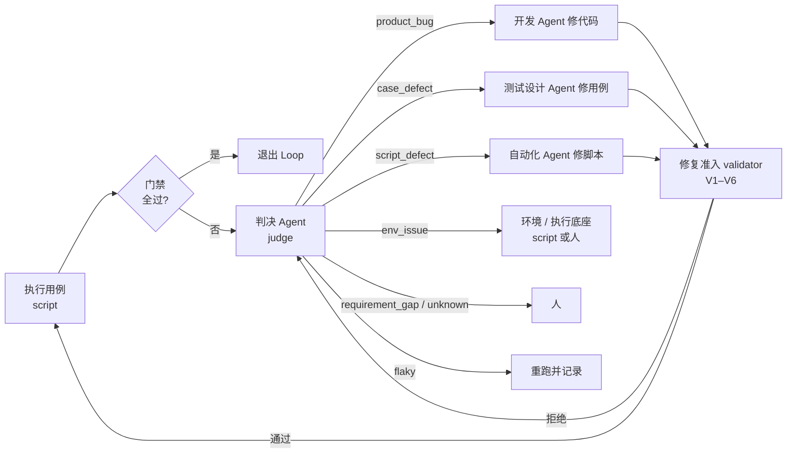

# 05 · 判决 Agent 与研发测试 Loop

## 解决什么问题

代码和自动化脚本都不可能一次百分百有效，实践中 AI 生成的用例脚本首跑一次可用的往往只有两三成，大部分要进修复。修复过程中最大的风险是**修错对象**：

- 代码有 bug，却去改脚本 → 掩盖缺陷；
- 用例写错，却去改代码 → 把错误需求实现进去；
- 环境挂了，却让开发和测试轮流"修" → 白烧轮次；
- AI 为了通过，删断言、放宽断言、跳过用例 → 假通过。

所以 Loop 里要有一个专门的**判决 Agent**：先判断失败到底是谁的问题，再交给对的人修，修完再用独立 validator 验。

## Loop 的形状

`loop` 节点包住这个子 DAG，`until` = 门禁全过，`maxIterations` 用完交人（onExhausted: 'human'）。

## 判决类别与路由

| VerdictCategory | 含义 | 默认路由 | 修复边界 |
|---|---|---|---|
| `product_bug` | 产品代码缺陷 | 开发 Agent | 只能改 `src/`，不能碰 `tests/` |
| `case_defect` | 用例本身错（预期写错、和需求矛盾） | 测试设计 Agent | 改用例属于基线变更，必须写决策记录 |
| `script_defect` | 脚本实现错（定位、等待、取值） | 自动化 Agent | 只能改脚本，不能删 / 弱化断言 |
| `env_issue` | 环境、数据、依赖、权限 | 执行底座 / 人 | 不改代码也不改脚本 |
| `flaky` | 不稳定 | 重跑，记录 | 连续 flaky 升级为 script_defect |
| `requirement_gap` | 需求 / 契约不清或互相矛盾 | 人（回到需求评审） | Loop 里不硬做 |
| `unknown` | 判不了 | 人 | — |

**判决的输入**：失败用例的证据目录（请求 / 响应 / 日志 / 截图 / 状态 diff）、用例、契约、spec、相关代码 diff。判决 Agent 能读代码、日志和数据库（只读），但不能写任何东西。

**判决的输出**（`JudgeVerdict`）：类别、置信度、理由、证据引用、修复类别（mechanical / semantic）、修复提示。

**权威顺序**：需求 / spec > 契约 > 用例 > 脚本 > 代码实现。冲突时按这个顺序裁决（沿用原型的看板规则）。

## 防假修复：修复准入 validator（V1–V6）

修复 Agent 交回来的改动，先过确定性检查再进下一轮：

| 检查 | 查什么 | 拦什么 |
|---|---|---|
| V1 改动分类 | 修复前后逐字段 diff：只改定位器 / 等待 → 可自动；改期望值、增删步骤 → 需要证据；删断言、断言变少、谓词变弱、吞异常、skip → 直接拒绝 | 删断言、放宽断言 |
| V2 验证点覆盖不减 | 每个验证点修复后仍至少有一条必选断言 | 悄悄丢验证点 |
| V3 业务请求序列不变 | 和上次全绿的运行比，业务请求和副作用一致 | 绕过功能 |
| V4 断言可证伪 | 把期望值换成错值，脚本必须失败 | 空断言 |
| V5 证据完整 | 截图、request_id、资源回读齐全 | 只截了标题 |
| V6 稳定性 | 干净环境连跑 3 次 | 偶然通过 |

结论四种：`AUTO_OK` / `NEEDS_EVIDENCE` / `NEEDS_HUMAN` / `REJECT`。MVP 先实现 V1（基于 diff 的规则）和 V6，其他留扩展点。

## 隔离：生成者和验证者分开

- 开发 Agent 的 writeScope 不含测试目录；测试 / 自动化 Agent 的 writeScope 不含产品代码。引擎在节点结束后做 git diff，越界的文件自动还原并记 `guard.violation`。
- 测试设计 Agent 不看代码（黑盒），按 spec 和契约写用例，避免用例被实现绑死。
- 判决 Agent 和修复 Agent 用不同会话；推荐判决用和开发不同厂商的模型。

## 判决本身也要评测

判错了怎么办：
- 人工复核过的判决样本回流成判决评测集；Web 的度量页展示**判决混淆矩阵**（人判 vs Agent 判）。
- 某类失败反复出现，说明上游有问题（模板、知识、CLI），报告里提示"回头治上游"，而不是在 Loop 里一遍遍修。
- 轮次上限 + 每条失败最多修 2 轮，超了交人。

## MVP 范围

- `judge` 节点 + 路由表 + VerdictCategory；`loop` 节点 + until + maxIterations。
- 写权限守卫（git diff + glob）。
- V1（规则版）、V6；判决结果写进 `reports/verdicts/`，Web 上可看。
- 示例流水线里用 mock harness 演示一次"失败 → 判决 → 路由 → 修复 → 通过"。
