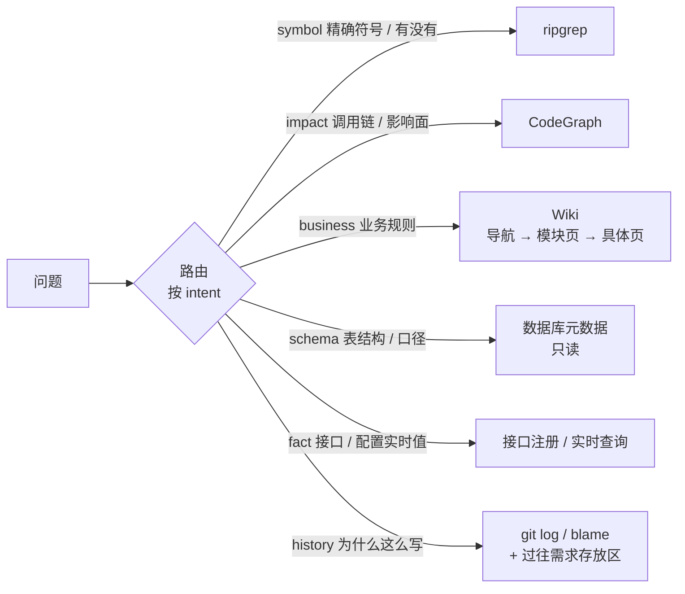

# 08 · 存量项目知识层

## 解决什么问题

新项目从零写，上下文就是需求本身。存量项目不一样：一个新需求通常十个接口里只新增一两个，其余都是存量能力的编排。Agent 需要知道历史业务逻辑、已有接口、表结构和字段口径、调用链和影响面，以及"为什么当初这么写"。只靠 grep 会漏同义词，只靠向量 RAG 会召回一堆无关内容撑爆上下文。

## 设计：先路由，再渐进式披露

- **按问题类型选检索器**：事实查实时接口、不信库里的副本；"不存在"类判断必须走精确搜索（CodeGraph 查不存在的符号会返回几十个模糊结果）。
- **渐进式披露**：先给目录和摘要，Agent 按需读全文；召回结果落成文件，不直接塞进上下文。
- **证据等级与时效**：每条命中带 `evidenceLevel`（verified / derived / stale / conflict）和取证时间，过期或冲突的只当参考。

## 接入方式

知识源实现 `KnowledgeSource` 接口（`packages/core/src/types.ts`）：

| kind | MVP | 说明 |
|---|---|---|
| `grep` | ✅ | ripgrep，精确符号、报错关键词 |
| `wiki` | ✅ | 一个 markdown 目录（LLM Wiki），按 index / 标题 / 别名入口召回 |
| `workspace` | ✅ | 过往需求的公共存放区（spec、决策、报告） |
| `git-history` | ✅ | `git log -S` / blame，回答"为什么" |
| `codegraph` | 接口 | 对接外部 CodeGraph 服务或本地索引工具 |
| `database` | 接口 | 只读连接，查表结构、字段注释、口径 |
| `api-registry` | 接口 | OpenAPI / 接口平台导出 |

Agent 用两种方式拿知识：
1. **节点预取**：`agent({ knowledge: [{ text: '…', intent: 'impact' }] })`，引擎在节点开始前检索，命中写进上下文账本；
2. **运行中自取**：Agent 调 `takt kb query "<问题>" --intent impact`（CLI，任何 harness 都能用），每次查询记 `knowledge.query` 事件，便于评估召回质量。

## 知识回流

需求准出后，`knowledge-writeback` 节点把 spec、决策、坑点整理成 Wiki 的 diff 提给人审，合入后下一个需求就能召回。失败归因为"知识缺失 / 错误 / 过期"的，也回流到这里。

## MVP 范围

grep / wiki / workspace / git-history 四个源 + 规则路由（intent 显式指定或关键词判断）+ `takt kb query`；CodeGraph / DB / API 只定义接口和一个空实现。
