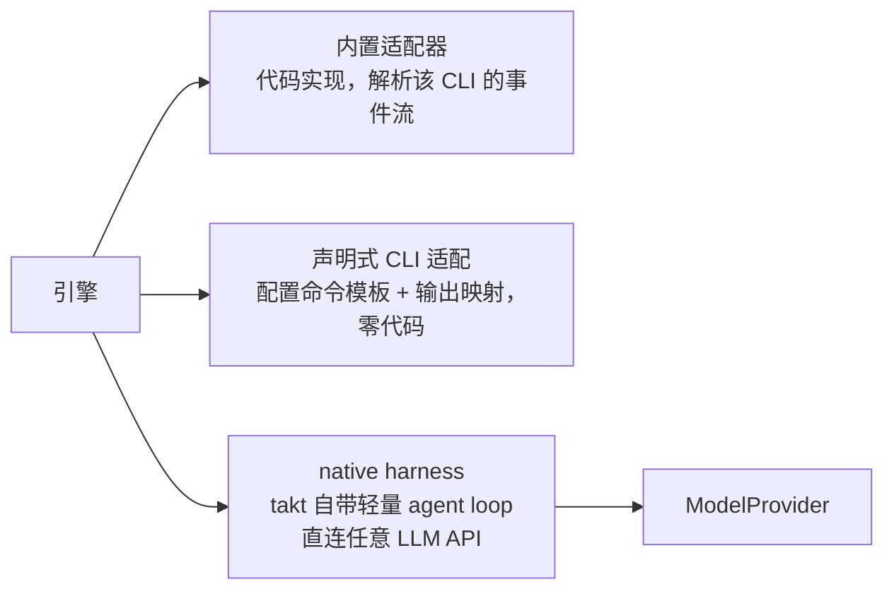

# 13 · 扩展性：支持哪些 harness 和 LLM API，怎么接入新的

## 解决什么问题

- Agent 工具迭代很快：今天主力是 Claude Code、Codex，明天可能是 Gemini CLI、Kimi CLI、Qwen Code 或某家自研 harness。流水线不能每接一家就改引擎。
- 模型也在换：同一个 harness 要能接不同厂商的模型（比如 Claude Code 接 GLM、Kimi），国内团队还要能接 DeepSeek、通义、豆包、私有化部署。
- 开源项目的生命力在社区贡献：第三方要能**不改主仓库**就加一个 harness、模型、知识源或节点类型。

## 五个扩展点

| 扩展点 | 接口 | 例子 |
|---|---|---|
| **Harness**（谁来跑 agent loop） | `HarnessAdapter` + `HarnessCapabilities` | Claude Code、Codex、Gemini CLI、自带的 native |
| **模型提供方**（LLM API） | `ModelProvider` | OpenAI 兼容接口、Anthropic Messages、Gemini |
| **知识源** | `KnowledgeSource` | CodeGraph、数据库、接口平台、内部 Wiki |
| **节点 / 流程包** | `NodeDef` 工厂函数 + `WorkflowDefinition` | 安全扫描节点、Bug 修复流程、发布流程 |
| **角色** | `.takt/agents/*.md` | DBA、安全评审、数据口径专家 |

都通过**插件**交付：一个 npm 包或项目里的 `.takt/plugins/*.ts`，默认导出 `definePlugin({ harnesses, providers, knowledge, workflows, roles })`，在 `takt.config.json` 的 `plugins` 里声明。插件声明 `apiVersion`，主版本不匹配时拒绝加载并提示。

## 一、Harness 的三种接入方式



1. **内置适配器**：对主流 harness 写专门的适配器，解析它们的结构化事件流（消息、工具调用、用量、会话 ID、压缩），上下文账本和 Trace 最完整。
2. **声明式 CLI 适配**（`kind: "cli"`）：任何"能非交互执行、能输出文本或 JSONL"的 CLI，都可以在配置里声明命令模板和输出字段映射，不用写代码：

   ```json
   {
     "id": "aider", "kind": "cli",
     "command": ["aider", "--yes-always", "--no-pretty", "--message-file", "{{promptFile}}"],
     "model": { "flag": "--model" },
     "output": { "format": "text" },
     "available": ["aider", "--version"]
   }
   ```
   JSONL 输出时用 `output.events` 声明字段映射（哪个字段是消息文本、哪个是工具调用、哪个是用量、哪个是会话 ID）。能力会自动降级：拿不到工具事件，Trace 就只有最终结果，写权限守卫照常靠文件 diff。
3. **native harness**：takt 自带一个极简 agent loop（工具：`read_file / write_file / edit_file / list / grep / bash`），直接调用任意 `ModelProvider`。适合：
   - 判决、planner、rubric 打分这类**结构化输出**节点（不需要一个完整的编码 harness，便宜、快、可控）；
   - 没有官方 CLI 的模型和私有化部署；
   - 需要**精确上下文账本**的场景：上下文是 takt 自己组装的，每个 token 来自哪里都清楚；写权限在工具层前置校验，不用事后 diff。

### 能力声明（HarnessCapabilities）

每个适配器声明自己支持什么，引擎据此降级而不是报错：

| 能力 | 含义 | 不支持时引擎怎么做 |
|---|---|---|
| `resume` | 能续上一个会话 | `session: 'resume'` 退化为新会话 + 注入上一轮的产物摘要 |
| `structuredOutput` | 原生支持输出 JSON Schema | 从最终文本里提取 ```json 代码块再校验 |
| `toolEvents` | 能报告工具调用 | Trace 只记录最终结果；"计划读 vs 实际读"对比不可用 |
| `usage` / `cost` | 能报告 token / 成本 | 按字符估算 token，成本按 `models` 里的单价算 |
| `compactionEvents` | 能报告上下文压缩 | 压缩时间线为空，账本标注"该 harness 不报告压缩" |
| `customProvider` | 能把模型指到别家 API | 只能用该 harness 自带的模型 |
| `sandbox` | 自带沙箱 / 权限模式 | 依赖 takt 的写权限守卫 |
| `mcp` | 支持 MCP | 知识层改为预取注入 + `takt kb query` CLI |

## 二、支持矩阵

### Harness

| harness | 无头调用 | 结构化事件 | 状态 |
|---|---|---|---|
| Claude Code | `claude -p --output-format stream-json --verbose` | ✅ | M0 |
| Codex | `codex exec --json`（stdin 传 prompt；`exec resume <id>` 续聊） | ✅ | M0 |
| DeepSeek Harness | `dsh --profile headless --json` | ✅（NDJSON 运行事件） | M0（需先登录） |
| mock | 进程内剧本 | ✅ | M0 |
| native | takt 内置 | ✅（自己产生） | M1 |
| Gemini CLI | `gemini -p "<prompt>" --output-format stream-json --yolo`（事件：init / message / tool_use / tool_result / error） | ✅ | M1 |
| Cursor Agent CLI | `cursor-agent -p --output-format stream-json [--model]`（事件格式与 Claude Code 一致） | ✅ | M1 |
| Qwen Code | `qwen -p "<prompt>" --output-format stream-json` | ✅ | M1 |
| Kimi CLI | `kimi --print -p "<prompt>" --output-format=stream-json`（print 模式隐含 yolo） | ✅ | M1 |
| OpenCode | `opencode run --format json "<prompt>"` | ✅ | M1 |
| GitHub Copilot CLI | `copilot -p "<prompt>" --allow-all-tools`（建议用 `--allow-tool` 收窄） | 待核实 | M1 |
| TRAE CLI | `traecli exec` | 待核实 | M1 |
| Aider / Goose / Amp 等 | 声明式 CLI 适配 | 视输出而定 | 社区 |

### LLM API（ModelProvider，供 native harness 使用，也用于给支持 customProvider 的 harness 换模型）

| 协议 | 覆盖 | 状态 |
|---|---|---|
| `openai-chat`（/v1/chat/completions） | OpenAI、DeepSeek、Moonshot（Kimi）、智谱 GLM、通义千问（DashScope 兼容模式）、火山方舟（豆包）、MiniMax、硅基流动、OpenRouter、Azure OpenAI，以及本地 Ollama / vLLM / LM Studio / LiteLLM | M1 |
| `anthropic-messages`（/v1/messages） | Anthropic；以及提供 Anthropic 兼容接口的厂商（如 DeepSeek、Kimi、GLM），这类接口也是"Claude Code 接国产模型"的基础 | M1 |
| `openai-responses`（/v1/responses） | OpenAI 新接口（推理模型、原生工具） | M2 |
| `gemini` | Google Gemini API | M2 |
| `bedrock` / `vertex` | 云厂商托管的 Claude / Gemini | M2 |

各厂商的 base URL 和模型名以官方文档为准，写在 provider 预设里，用户可覆盖。

## 三、harness × 模型怎么组合

`HarnessSelector` 增加 `provider` 字段：

```json
{
  "providers": {
    "glm":      { "protocol": "anthropic-messages", "baseURL": "<GLM 的 Anthropic 兼容地址>", "apiKeyEnv": "GLM_API_KEY" },
    "deepseek": { "protocol": "openai-chat", "baseURL": "https://api.deepseek.com", "apiKeyEnv": "DEEPSEEK_API_KEY" },
    "local":    { "protocol": "openai-chat", "baseURL": "http://127.0.0.1:11434/v1" }
  },
  "models": {
    "glm-5":       { "provider": "glm", "id": "glm-5", "contextWindow": 200000, "price": { "input": 0, "output": 0 } },
    "deepseek-v4": { "provider": "deepseek", "id": "deepseek-chat", "contextWindow": 128000 }
  },
  "roles": {
    "dev":   { "harness": "claude-code", "model": "glm-5" },
    "judge": { "harness": "native", "model": "deepseek-v4" }
  }
}
```

- harness 声明了 `customProvider`，适配器就负责把 provider 翻译成它认识的配置：
  - Claude Code：注入 `ANTHROPIC_BASE_URL / ANTHROPIC_AUTH_TOKEN / ANTHROPIC_MODEL`；
  - Codex：`-c model_provider=<id> -c model_providers.<id>.base_url=... -c model_providers.<id>.env_key=...`；
  - 其他 harness 按各自的环境变量或配置文件。
- harness 不支持 customProvider 而配置了 provider，`takt doctor` 和 workflow 加载时直接报错，不在运行中才失败。
- 选型结论要靠评测，不要写死（见 09 的"评测"）。

## 四、密钥与安全

- 配置里只写**环境变量名**（`apiKeyEnv`），不写密钥；`takt doctor` 只检查变量是否存在，不打印值。
- transcript 和事件落盘前，按已知变量值和常见密钥格式脱敏。
- native harness 的 `bash` 工具默认关闭，需要在角色或节点上显式开启；开启后受写权限守卫约束。

## 五、可发现、可诊断、可验证

- `takt harness ls` / `takt doctor`：列出已注册的 harness、provider、model，逐个检查可用性（可执行文件、登录状态、环境变量），显示能力矩阵。Web 的"设置"页显示同一张表。
- **一致性测试套件**：`@taktflow/harness/testing` 提供一组契约测试（解析录制好的事件流、超时取消、错误分类、结构化输出提取）。新适配器（包括社区插件）跑过这套测试才算合格，这是开源协作的门槛。

## MVP 落地顺序

- **M0（进行中）**：claude-code、codex、dsh、mock；HarnessSelector 优先级与降级链。
- **M1**：`ModelProvider` + openai-chat / anthropic-messages 两个协议 + 厂商预设；native harness；声明式 CLI 适配；Gemini / Cursor / Qwen / Kimi / OpenCode 适配器；`definePlugin` 插件加载；`takt harness ls / doctor`；一致性测试套件；Web 设置页。
- **M2**：openai-responses、gemini、bedrock、vertex；插件目录与发布规范。
