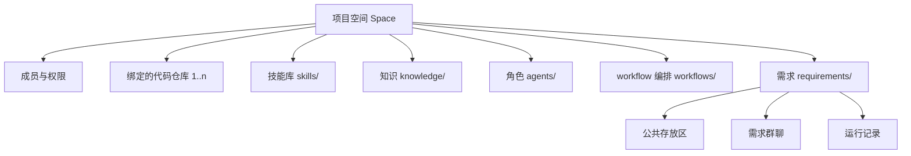

# 14 · 项目空间

## 解决什么问题

M0 把"项目"等同于"一个带 `.takt/` 的代码仓库"。真实团队不是这样：

- 一个业务往往对应**多个代码仓库**（前端、后端、测试、配置）；
- 技能（Skill）、知识、角色、workflow 是**团队资产**，应该跟着业务走，而不是散落在某个代码仓库里；
- 需求物料（PRD、spec、用例、报告）和代码是两种东西：视频里的做法就是单独一个"物料仓库"。

所以需要一个比代码仓库高一层的容器：**项目空间**。

## 模型



一个空间就是一个目录，推荐作为一个独立的 git 仓库（"物料仓库"）：

```
<space>/
  takt.config.json        # 空间配置：名称、成员、绑定仓库、角色默认 harness、provider、模型……
  agents/<role>.md        # 角色档案
  skills/<name>/SKILL.md  # 技能库：运行时按 harness 同步到沙箱里各自的技能目录
  knowledge/              # Wiki 与知识源配置
  workflows/<id>.workflow.ts + <id>.layout.json
  requirements/<REQ>/     # 公共存放区（PRD、spec、系分、用例、证据、评审记录、报告…）
  .takt/                  # 运行时状态（不建议提交）：runs、objects、chat、attention、repos 镜像
```

- **绑定代码仓库**（`repos`）：`{ id, url, path, defaultBranch, purpose }`。运行时把仓库镜像到 `.takt/repos/<id>`，每个写代码的任务从镜像开一个 git worktree，各自一个分支，互不冲突（见 [17](17-文件系统与沙箱.md)）。
- **技能库**：空间级 Skill，节点运行前同步进沙箱里该 harness 认识的目录（`.claude/skills`、`.agents/skills` 等），所以同一份 Skill 所有 harness 都能用。
- **成员**：`owner / maintainer / member / viewer`；审批、改 workflow、改配置分别需要不同角色。
- **兼容 M0**：代码仓库里直接 `takt init` 仍然可用，等价于"空间和唯一的代码仓库放在一起"（`repos: [{ id: 'main', path: '.' }]`），旧的 `.takt/agents`、`.takt/workflows`、`.takt/workspaces` 照常读取。

## 多空间

`takt serve --spaces <dir>`：目录下每个含 `takt.config.json` 的子目录是一个空间。Web 左上角切换空间；单空间模式（`--project`）保持不变。

## Web

- 空间首页：需求列表 + 阶段条 + 待办 + 度量。
- 空间设置：成员 / 代码仓库 / 技能 / 知识 / 角色 / workflow / 模型与 harness。技能和角色可以在线编辑（写回文件、留痕）。

## CLI

`takt space create|ls`、`takt repo add|ls|sync`、`takt skill add|ls`、`takt member add|ls`。
