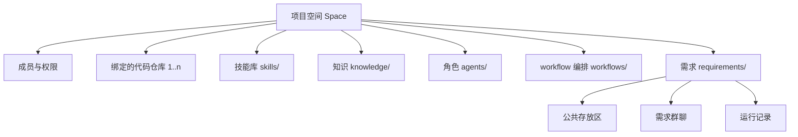

# 14 · 项目空间

## 解决什么问题

M0 把"项目"等同于"一个带 `.takt/` 的代码仓库"。真实团队不是这样：

- 一个业务往往对应**多个代码仓库**（前端、后端、测试、配置）；
- 技能（Skill）、知识、角色、workflow 是**团队资产**，应该跟着业务走，而不是散落在某个代码仓库里；
- 需求物料（PRD、spec、用例、报告）和代码是两种东西：视频里的做法就是单独一个"物料仓库"。

所以需要一个比代码仓库高一层的容器：**项目空间**。

## 模型



一个空间就是一个目录，推荐作为一个独立的 git 仓库（"物料仓库"）：

```
<space>/
  takt.config.json        # 空间配置：名称、成员、绑定仓库、角色默认 harness、provider、模型……
  agents/<role>.md        # 角色档案
  skills/<name>/SKILL.md  # 技能库：运行时按 harness 同步到沙箱里各自的技能目录
  knowledge/              # Wiki 与知识源配置
  workflows/<id>.workflow.ts + <id>.layout.json
  requirements/<REQ>/     # 公共存放区（PRD、spec、系分、用例、证据、评审记录、报告…）
  .takt/                  # 运行时状态（不建议提交）：runs、objects、chat、attention、repos 镜像
```

- **绑定代码仓库**（`repos`）：`{ id, url, path, defaultBranch, purpose }`。运行时把仓库镜像到 `.takt/repos/<id>`，每个写代码的任务从镜像开一个 git worktree，各自一个分支，互不冲突（见 [17](17-文件系统与沙箱.md)）。
- **技能库**：空间级 Skill，节点运行前同步进沙箱里该 harness 认识的目录（`.claude/skills`、`.agents/skills` 等），所以同一份 Skill 所有 harness 都能用。一个技能是一个**文件夹**：`SKILL.md`（frontmatter 的 name / description + 做法）之外，可以带 `references/`（长参考资料，用到再读）、`scripts/`（可执行脚本）、`assets/`（模板、图片）。同步、配方哈希都按整个文件夹算，改其中任何一个文件都算技能变了。
- **成员**：`owner / maintainer / member / viewer`；审批、改 workflow、改配置分别需要不同角色。
- **兼容 M0**：代码仓库里直接 `takt init` 仍然可用，等价于"空间和唯一的代码仓库放在一起"（`repos: [{ id: 'main', path: '.' }]`），旧的 `.takt/agents`、`.takt/workflows`、`.takt/workspaces` 照常读取。

## 多空间

`takt serve --spaces <dir>`：目录下每个含 `takt.config.json` 的子目录是一个空间。Web 左上角切换空间；单空间模式（`--project`）保持不变。

## Web

- 空间首页：需求列表 + 阶段条 + 待办 + 度量。
- 空间设置：成员 / 代码仓库 / 技能 / 知识 / 角色 / workflow / 模型与 harness。技能和角色可以在线编辑（写回文件、留痕）。

### 技能：文件夹与导入

技能页左边是技能列表，右边是这个技能的文件树和编辑器：文本文件（≤1 MB 的 UTF-8）直接改，二进制文件只显示大小、靠上传同名文件替换。能新建文本文件、上传文件、删文件（`SKILL.md` 不能单独删）、删整个技能；每次写入都要写原因，进空间审计（`space-events.jsonl`），写入走受控写入，运行中的写保护不会误报。

导入有两种来源，都是**先预览再导入**：

| 来源 | 怎么给 | 说明 |
|---|---|---|
| Git 仓库 | GitHub 网页地址（可带 `/tree/<分支>/<目录>`、`/blob/…/SKILL.md`）、`owner/repo` 简写，或任意 https / SSH 地址；可另填分支 / 标签 / 提交和子目录 | 服务端浅拉取（`--depth 1`）；给了子目录就只拉那一部分（部分克隆 + 稀疏检出）。私有仓库用服务端本机的 git 凭据，不弹交互；只允许 https / SSH，拒绝本地路径和 `file://`；审计里的来源去掉了地址里的凭据 |
| 本地上传 | 拖进来一个或多个技能文件夹，或选 `.zip` / `.skill` 包 | 浏览器把文件按相对路径传上去，zip 在服务端解开（不支持 zip64 和加密包）；`.git`、`__MACOSX`、`.DS_Store` 不要 |

预览时服务端把来源放进系统临时目录（30 分钟过期，令牌只在发起的空间里有效），找出所有带 `SKILL.md` 的目录作为候选：名字取 frontmatter 的 name（不合法就用目录名），标出已有同名和不能导入的原因。导入时可以改名（会同步改 frontmatter 的 name，目录名和 name 保持一致），同名要勾「覆盖」才整个替换。符号链接一律跳过，路径不能出技能目录。

上限（同步进每个工作目录、算进配方哈希，太大会拖慢每次运行）：一个技能最多 500 个文件、共 20 MB，单个文件 5 MB；一次上传 30 MB。

## CLI

`takt space create|ls`、`takt repo add|ls|sync`、`takt skill add|ls`、`takt member add|ls`。
