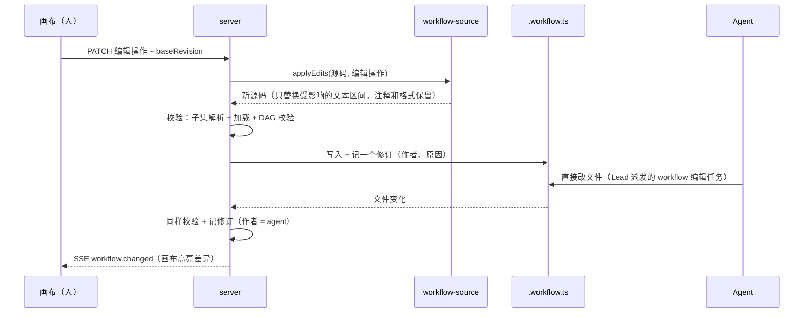

# 16 · workflow 协同编辑：人拖拽、AI 改代码，改的是同一个文件

## 解决什么问题

workflow 要能被人和 AI 一起改：人在页面上用拖拽、表单的低代码方式改，AI 直接改代码文件。如果两边各存一份（画布存 JSON、AI 改 TS），很快就对不上。

## 决定：`.workflow.ts` 的受限子集是唯一事实源

```ts
export default defineWorkflow({
  id: 'sdlc', title: '…', version: '0.2.0',
  stages: [ { id: 'understand', title: '需求理解' }, … ],
  nodes: [
    agent({ id: 'spec', title: '写 PRD', role: 'pm', prompt: '…' }),          // 字面量属性：画布表单可编辑
    review({ id: 'review-prd', target: ['spec/prd.md'], reviewers: [{ role: 'rd' }, { role: 'test' }],
             author: { role: 'pm' }, maxRounds: 3, onExhausted: { rework: 'spec', maxReworks: 1 } }),
    agent({ id: 'fix', title: '修复', role: 'dev', prompt: hooks.repairPrompt('fix') }), // 代码值：画布显示为代码块
  ],
})
```

**受限子集的规则**（`takt workflow lint` 检查）：
1. 默认导出是 `defineWorkflow({...})`，参数是对象字面量；
2. `stages`、`nodes`（以及 loop 的 `body`）是数组字面量；
3. 每个节点是一次节点构造函数调用（`agent / script / gate / human / judge / loop / planner / review / subflow`），参数是对象字面量；
4. 属性值可以是任意表达式：字面量（字符串、数字、布尔、字面量数组 / 对象）在画布上用表单编辑；其他表达式（函数、调用、变量引用）是**代码值**，画布上显示为代码块，可以直接改文本。

不满足子集的文件照样能运行，只是画布变成只读，并提示原因。

**画布坐标**存旁路文件 `<id>.layout.json`，不污染代码 diff。

## 编辑链路



- **编辑操作**：加节点、删节点、改属性（字面量或代码值）、改依赖（连线）、调整顺序、加 / 改阶段、改元信息。全部是对 AST 定位后的**最小文本替换**，不重新打印整个文件。
- **并发**：乐观锁。请求带 `baseRevision`（源码的 sha）；不一致时服务端尝试三方合并，合并失败返回冲突，画布展示双方差异让人选。
- **修订历史**：每次保存一个修订（源码快照、作者、原因、基于哪个修订）；可回看差异、回滚。空间是 git 仓库时同时提交 commit。直接改源码文件的外部修改，由编辑器打开或订阅时补记一个修订；空间概览、管家、Lead 的读取不补记。修订和布局的写入都走服务端受控写入，运行中节点的写权限守卫不会把它们算成 agent 越界。
- **运行固定版本**：运行开始时固定 workflow 修订（已有快照）；改动只影响之后的运行。
- **需求级覆盖**：某个需求需要特殊流程时，可以把 workflow 复制到该需求下单独修改，不影响空间里的模板。

## 画布能力

节点面板（拖入新节点）、连线改依赖、属性面板（表单 + 代码值编辑器）、阶段泳道拖动、校验错误就地标红、保存 / 撤销、修订历史与差异、AI 修改实时高亮。
