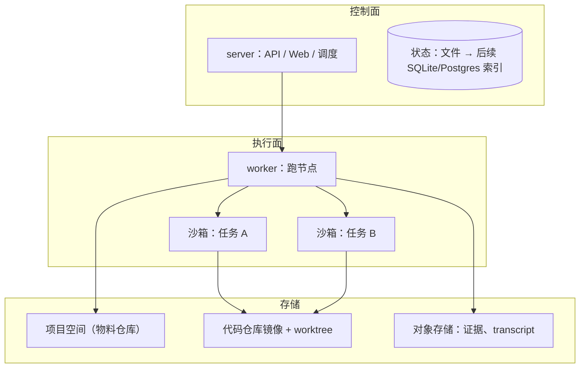

# 17 · 文件系统、沙箱与部署

## 解决什么问题

- 上生产大概率部署在云端 Linux，多个需求、多个 Agent 同时跑：Agent 之间不能互相踩文件，不能拿到不该拿的密钥，也不能把机器搞坏。
- 本地开发又要轻：不能要求每个人先装 Docker 才能试用。

## 三层

### 文件系统

- **项目空间**：一个目录（推荐 git 仓库），见 [14](14-项目空间.md)。
- **代码仓库**：镜像到 `.takt/repos/<id>`；每个写代码的任务开一个 worktree（`.takt/worktrees/<run>/<node>`，分支 `takt/<run>/<node>`），任务结束后由集成节点合并或交人处理冲突。依赖同仓库上游任务的，引擎先把上游 worktree 的改动提交到它的分支，再从那里开（多个上游依次合并，冲突则节点阻塞）；节点也可以用 `base` 指定从哪个分支开，比如修复代码从集成分支开。任务分支合进集成分支 `takt/<run>/integration`；人工准出后，标准流水线的「合入主干」节点把它合进仓库的默认分支（只在本地合，不推远端；默认分支检出着就在仓库目录里合，否则借临时 worktree 合；冲突时中止合并、节点失败，手动合好后重试）。
- **大文件**：证据截图、transcript 走内容寻址的对象存储（本地是 `.takt/objects`，云端可换 S3 / TOS），存放区里只放引用。

### 沙箱（SandboxProvider，三档可插拔）

| 提供方 | 平台 | 隔离 | 用途 |
|---|---|---|---|
| `local` | macOS / Linux | 不隔离，依赖写权限守卫 | 本地开发、试用 |
| `bwrap` | Linux | bubblewrap：只读根文件系统 + 可写挂载点白名单 + 可选断网 | 单机部署、CI |
| `docker` | Linux / macOS（装了 Docker） | 每个任务一个容器，镜像里预装各家 CLI；资源限制、网络策略 | 云端默认 |

沙箱规格：工作目录、挂载（worktree 读写、存放区读写、技能和知识只读）、环境变量（只注入该任务需要的密钥）、网络策略、资源上限、超时。harness 的子进程都通过沙箱启动，所以同一个适配器在三种沙箱下行为一致。

写权限守卫覆盖 `.takt/worktrees/**`：无 repo 节点写工作树、或有 repo 节点写未分配给它的工作树均记越界；`.git` 内部文件和受控系统写入除外，工作树用文件元数据缓存哈希以避免每个执行窗口全量读取内容。

native harness 的 bash 工具：macOS 用 sandbox-exec，Linux 用 bwrap（或所在容器本身），都不可用时 bash 工具不提供。

## Linux 与部署

- 代码不写死 macOS 路径（DeepSeek Harness 等可执行文件路径用环境变量覆盖）。
- CI：GitHub Actions 在 ubuntu 和 macOS 上跑类型检查、全量测试、demo、Web 构建、Docker 镜像构建。
- 交付物：`Dockerfile`（server + worker 一个镜像，Node 22 + git + ripgrep + bubblewrap，可选预装 Claude Code / Codex / OpenCode / Pi 等 CLI）、`docker-compose.yml`（server + 数据卷）。
