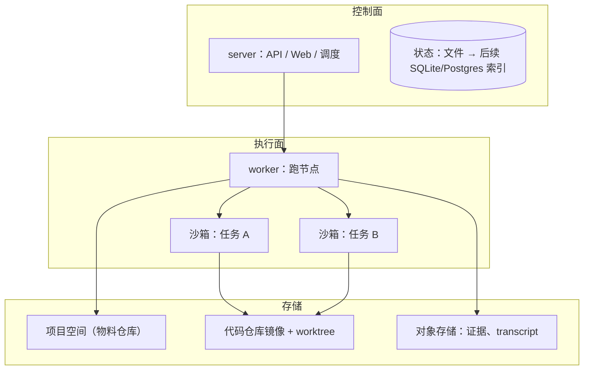

# 17 · 文件系统、沙箱与部署

## 解决什么问题

- 上生产大概率部署在云端 Linux，多个需求、多个 Agent 同时跑：Agent 之间不能互相踩文件，不能拿到不该拿的密钥，也不能把机器搞坏。
- 本地开发又要轻：不能要求每个人先装 Docker 才能试用。

## 三层



### 文件系统

- **项目空间**：一个目录（推荐 git 仓库），见 [14](14-项目空间.md)。
- **代码仓库**：镜像到 `.takt/repos/<id>`；每个写代码的任务开一个 worktree（`.takt/worktrees/<run>/<node>`，分支 `takt/<run>/<node>`），任务结束后由集成节点合并或交人处理冲突。
- **大文件**：证据截图、transcript 走内容寻址的对象存储（本地是 `.takt/objects`，云端可换 S3 / TOS），存放区里只放引用。

### 沙箱（SandboxProvider，三档可插拔）

| 提供方 | 平台 | 隔离 | 用途 |
|---|---|---|---|
| `local` | macOS / Linux | 不隔离，依赖写权限守卫 | 本地开发、试用 |
| `bwrap` | Linux | bubblewrap：只读根文件系统 + 可写挂载点白名单 + 可选断网 | 单机部署、CI |
| `docker` | Linux / macOS（装了 Docker） | 每个任务一个容器，镜像里预装各家 CLI；资源限制、网络策略 | 云端默认 |

沙箱规格：工作目录、挂载（worktree 读写、存放区读写、技能和知识只读）、环境变量（只注入该任务需要的密钥）、网络策略、资源上限、超时。harness 的子进程都通过沙箱启动，所以同一个适配器在三种沙箱下行为一致。

native harness 的 bash 工具：macOS 用 sandbox-exec，Linux 用 bwrap（或所在容器本身），都不可用时 bash 工具不提供。

## 被测环境

`TaktConfig.environment?` 是可选的部署配置；不配置时环境节点为 `skipped`，原流程保持不变：

```ts
environment: {
  deploy: 'docker compose up -d --build',
  healthcheck: { url: 'http://localhost:3000/health', timeoutMs: 120_000 },
  setup: 'npm ci',
  teardown: 'docker compose down',
  env: { API_TOKEN: '${TEST_API_TOKEN}' },
}
```

- 冻结后、测试 Loop 前执行 `env-setup`（配置了 setup 才运行），每个运行只准备一次。标准模板在分支集成后准备，命令在集成 worktree 执行；无集成目录时使用空间根。
- 每轮先 `deploy-env`，执行 deploy，再检查就绪。健康检查只能配置 command 或 HTTP(S) URL 之一，默认总超时 120 秒，失败后每 2 秒探测；每次探测也受总超时限制。部署或健康检查失败后，整套部署自动重试一次。
- 每轮写 `evidence/env/round-<n>.json`：命令、退出码、耗时、最多 4KB 日志尾部、健康检查和重试记录。环境变量值支持引用宿主 `${ENV_NAME}`；引用缺失立即报错，输出、命令和证据中的配置变量值均脱敏。用例进程收到这些变量及 URL 检查对应的 `TAKT_ENV_URL`。
- 环境失败时不执行用例，清除旧汇总并生成一条 subject=environment、status=error 的失败，指向本轮环境证据；判决确定归类为 `env_issue`，沿已有路由交人。
- Loop 完成后运行 `env-teardown`；引擎在失败或取消时补做回收（包括等待人工处理时取消），回收错误只记日志。取消先终止当前进程组，再用独立、最多 120 秒的取消信号回收，避免已取消信号跳过回收。准备、部署、检查及回收均使用 `runShellCommand` 的进程组终止机制。等待人工处理不算运行终止；恢复后继续，setup 不重复。
- 这是环境专用收尾，不新增通用 DAG `always` 协议。进程被强杀或宿主断电时无法执行收尾；回收命令应可重复执行，异常中断后由人工回收。

`takt init` 发现 `docker-compose.yml` 或 `compose.yaml` 时提示上述 Compose 命令，不自动启用部署。

## Linux 与部署

- 代码不写死 macOS 路径（DeepSeek Harness 等可执行文件路径用环境变量覆盖）。
- CI：GitHub Actions 在 ubuntu 和 macOS 上跑类型检查、全量测试、demo、Web 构建、Docker 镜像构建。
- 交付物：`Dockerfile`（server + worker 一个镜像，Node 22 + git + ripgrep + bubblewrap，可选预装 Claude Code / Codex / OpenCode / Pi 等 CLI）、`docker-compose.yml`（server + 数据卷）。
